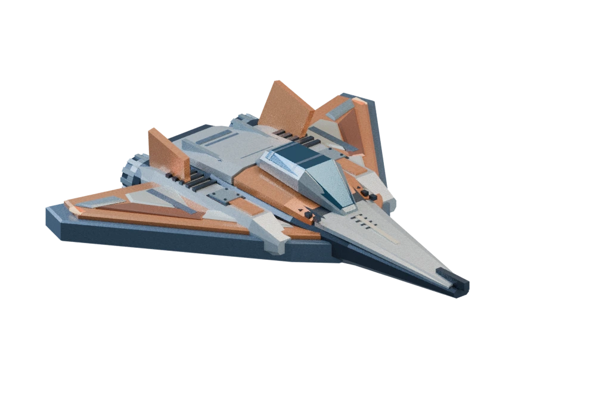
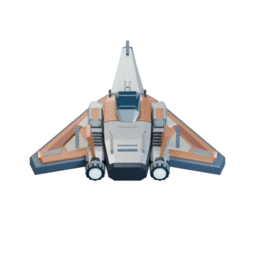
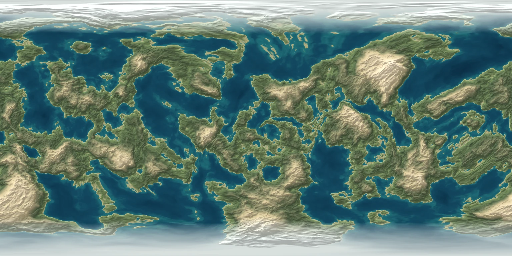
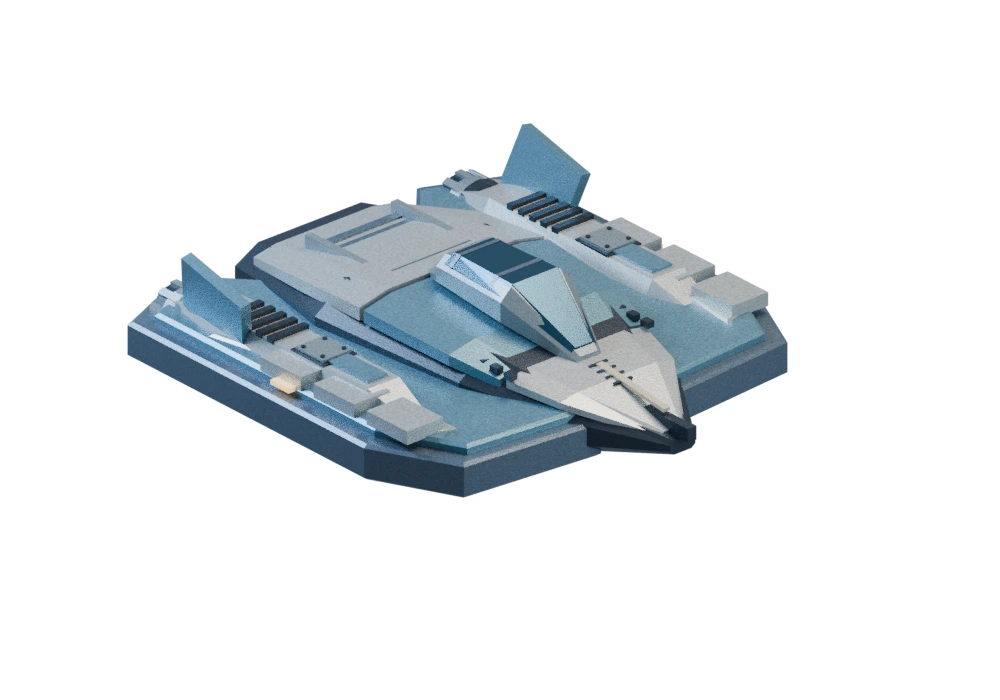
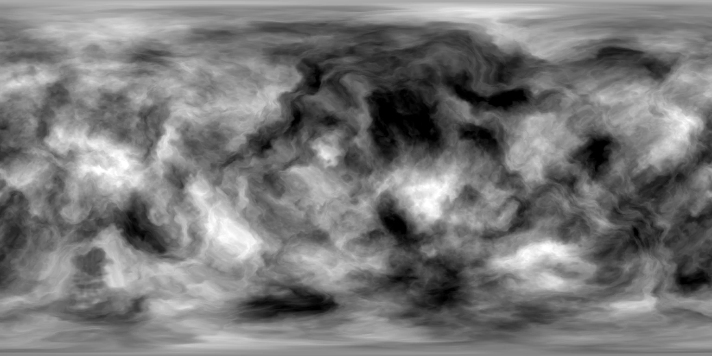

<div align="center">

# ASHEN REACH

### A living science-fiction universe.



**Fly beyond the horizon. Build a life among the stars.**

[Play the game](https://freddycreates.github.io/Ashen-Reach/) · [Universe & game design](GAME-PLAN.md) · [Studio development](DEVELOPMENT.md)

</div>

## Your ship. Your crew. Your frontier.

Explore four founding worlds, command Astra at the helm, recover the voices of the lost Nine Lanterns convoy, mine resources and establish a foothold in a growing civilization.

<table><tr><td width="50%"><br><strong>Take the helm</strong><br>Planetary flight and orbital navigation.</td><td width="50%"><br><strong>Discover the Reach</strong><br>Distinct worlds and expanding frontiers.</td></tr><tr><td><br><strong>Command your vessel</strong><br>Three hulls with individual roles.</td><td><br><strong>Explore and build</strong><br>Survey, extract and construct field stations.</td></tr></table>

*Gallery: existing repository game assets, not captured gameplay or the new cinematic target renders.*

## The next horizon

Nacre's monumental coastal harbor defines the studio's visual direction: ivory ceramic and basalt architecture, orange industrial markings, warm dusk lighting, ocean cliffs, freight traffic and a clean cyan-and-amber cockpit. The connected harbor milestone will link physical docking, walkable markets, cargo and boarding. The cinematic reference images are not yet published in this repository; current rendering is still below their fidelity.

See the [visual production specification](VISUAL-DIRECTION.md) for the scene and gameplay acceptance criteria.

## Hearth Harbor and pilot interior

Board a ship, open **Bridge → Hearth harbor**, plot Nacre and request the N-04 approach. Secure the landing gear within the validated speed and clearance envelope to access exchange and repair services. Press **V** during continuous flight to switch to the physical cockpit with live instruments when WebGL is available. The lower-detail HUD remains the fallback. Walkable harbor interiors and cinematic visual parity are not yet released.

[Studio design archive](game-design/README.md)

## Current build and technical documentation

An offline-capable science-fiction RPG and living-world simulation in development. Pilot three hulls, fly from orbit to the surface, and call a spirit into battle. The [studio production bible](GAME-PLAN.md#studio-production-bible--expansion-mandate) sets the direction for connected ports, autonomous crews, civilization and fleet ownership.

## Play The Choir Line

Board a hull, open **Bridge → The Choir Line** and trace the Nine Lanterns distress call. Mine ferrite on Aurelia, fit the repeater at Nacre, and bring a spirit into the Orison blockade. The final broadcast changes the price of a future cargo sale or the time it takes your spirit to answer.

After either Choir Line ending, select **Continue · Borrowed Air** in the ship log. Extract four ammonia on Veyra and choose the clinic or condenser delivery. This initial Act II slice persists the outcome and pays the fleet once; physical docking and downstream station simulation are future work.

For an agent-flown trip, open **Crew station → Command a landing** and choose a body. Astra takes the helm, operates the flight simulation, checkpoints the order and records the landing coordinates. Moving the stick gives the captain control.

Land on Aurelia and extract four ferrite to construct a field station from the bridge. Its building and beacon stay at the construction coordinates. Return within 65 metres for hull repairs or a cargo refit. Open the crew landing atlas to see saved touchdown locations.

The [game plan](GAME-PLAN.md) describes the setting, campaign and connected economy. The [development grid](DEVELOPMENT.md) links each workstream to a GitHub issue and a playtest.

## Runtime
space.mjs owns captain state, deck movement, combat, chart navigation, and local claims. space-view.mjs renders the simulation using WebGL or a projected canvas view. universe.mjs defines the shared deterministic frontier. A colony governor scores unmet district needs and specializes in housing, power, or industry. Each quarter-hour completes one project. Every eight cycles opens one world. The star chart reconstructs elapsed cycles without per-tick replay. Ships and claims persist in browser storage.

## Observatory
Run node server/observatory.mjs with PORT and STATE_DIR set for a persistent single-writer service. It advances independently of browsers and atomically publishes a frontier checkpoint. GET /api/frontier and GET /api/worlds/0 return the clock and governors. Static hosting computes the same simulation from its clock. The observatory is optional and is not an authoritative ownership server.

## Verification
Run `node --test test/*.mjs`. This release includes comprehensive tests for deterministic celestial physics, mining ledgers, campaign state, embodied Astra pilot neural weights, 3D mesh budgets, the WebAudio procedural sound synthesizer, and the AI agent harness.

## AI Engine & Agent Harness ("Embodied AI & For AI")
- **Embodied Tactical Crew**: Astra actively analyzes sensory telemetry, providing real-time voice and tactical radio comms (`comms.say(...)`), terrain collision warnings, and combat advice.
- **Autonomous Policies**: Astra features autonomous planetary approach and landing with a 64-node neural network controller (`dist/pilot-weights.mjs`) and autonomous dogfighting policy.
- **Open AI Agent Harness (`window.AshenReachAI`)**:
  - `AshenReachAI.getPerception()`: Emits structured telemetry (3D coordinates, velocities, nearest planetary bodies, radar contacts, and threats).
  - `AshenReachAI.step(action)`: Accepts programmatic control signals (`{turn, throttle, lift, pitch, fire, summon}`).
  - `AshenReachAI.setAutopilot('combat' | 'survey' | 'transit')`: Enables autonomous gameplay agents.
  - Live AI Neural Telemetry HUD: Real-time visualizer displaying sensory radar and 64-node neural network activations.

## Next-Gen Visuals & Audio Engine
- **Atmospheric Scattering**: Dynamic Rayleigh/Mie limb scattering that shifts with sun direction and planet composition.
- **Volumetric Starfield & Cosmic Nebula**: Multi-layered spectral stars with scintillation and procedural nebula backdrops.
- **Dynamic Thruster Particles & VFX**: Ion exhaust sparks, kinetic recoil camera trauma shake, shield deflection ripples, and muzzle flares.
- **Cockpit HUD & Dual Camera Modes**: First-person cockpit pilot perspective and 3rd-person chase camera with lead target reticles and pitch ladders (press `V` to toggle).
- **Procedural WebAudio Synthesizer**: Zero-asset procedural audio system generating dynamic thruster hum, laser chirps, explosion rumbles, sacred spirit chimes, warp sweeps, and ambient space music.

## Expanding Planetary Worlds & Sophisticated Spheres
- **Continuous Planetary Expansion (Seamless Scale Growth)**: As ships descend from deep space or orbital cruise toward any world, planetary bodies scale organically with adaptive quadtree level-of-detail (LOD) up to 23 levels of subdivision. The planet genuinely feels like an expanding world rather than a flat billboard.
- **Biome & Ocean Specular Rendering**: Rich per-vertex planetary shader coloring distinguishes deep oceans, coastal shelves, elevation-tinted continental rock strata, polar frost caps, and convective gas-giant storm bands. High-glance sun angles produce real ocean specular glints.
- **Dual-Layer Convective Clouds**: Dual-altitude independently rotating cloud and cirrus decks provide depth to planetary atmospheres from orbit.
- **Ultra-Wide Horizon Surface Survey LOD**: Surface exploration features four nested continuous detail rings up to 12.3 km horizon radius, rendering expansive planetary vistas with micro-grain ripples, rock debris, and atmospheric distance haze.
- **Atmospheric Descent Transition**: Direct contextual descent transition corridors from orbital flight into surface survey flight mode.

## Fleet graphics

Select a hull to inspect it, drag the hangar view to rotate it, then board. Each hull has its own silhouette. The frigate carries modular armor. The cutter has forward-swept vanes. The interceptor has a swept delta wing. All share fittings from the fleet's engineering kit.

Serve the packaged build with `python3 -m http.server 8000 --directory dist`. Open `http://localhost:8000`. Run `npm test` for mesh, lighting, and universe checks. No runtime package install is needed.

The WebGL renderer uses indexed meshes grouped by material, baked vertex occlusion, a roughness and bump texture, an environment reflection map, and a maximum initial drawing buffer of 1.9 million pixels. It lowers resolution when sustained frame times exceed 30 ms. The non-WebGL renderer uses Blender renders of the same hulls, a depth-tested walkable deck, and pre-lit planet discs. It loads additional hangar angles on demand. The game includes four planetary surface families.

## Rebuilding art

The game serves all visual assets locally. Regenerate surfaces with `python3 tools/bake-space.py` (NumPy, SciPy, Pillow). From the project root, run the following to rebuild the fleet assets with Blender and Pillow.

```sh
mkdir -p /tmp/reach-bake
node tools/export-models.mjs /tmp/reach-bake/models.json
blender -b -P tools/bake-occlusion.py -- /tmp/reach-bake/models.json "$PWD/dist/art"
blender -b -P tools/bake-views.py -- /tmp/reach-bake/models.json /tmp/reach-bake
python3 tools/encode-views.py /tmp/reach-bake dist/art
```

## Frontier release
Open **Bridge** after boarding. **Orbital navigation** integrates a two-body orbit with manoeuvring thrust. **Surface survey** places your ship in a local atmospheric flight region with gravity, drag and beacon scans. **Enter freeport** opens a district with carriers, customs ships, station contracts and refits. **Crew station** assigns Astra to fly a survey or returns control to the player. Crew identity and the latest 48 activity records are saved in this browser profile. These game agents run locally while playing. The campaign has separate navigation, atmospheric and combat modes.
